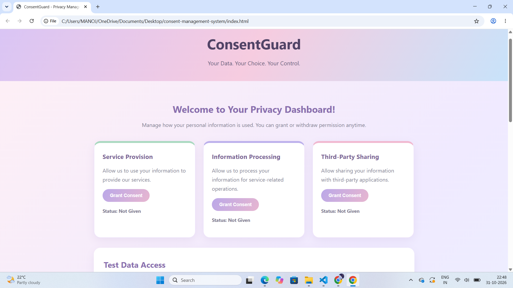
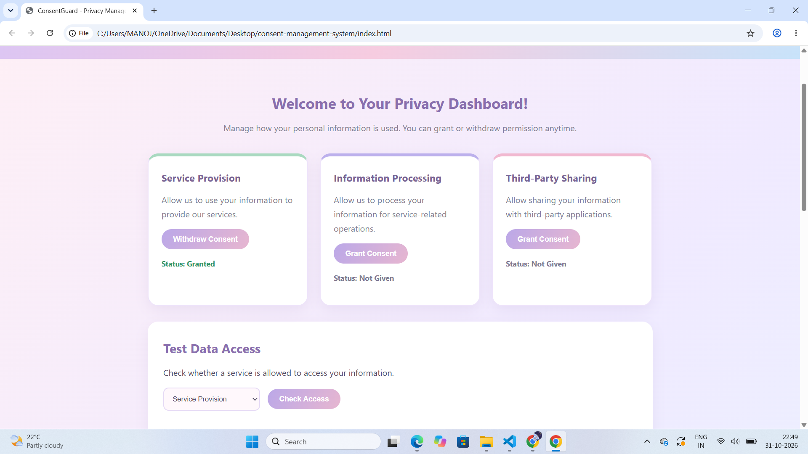
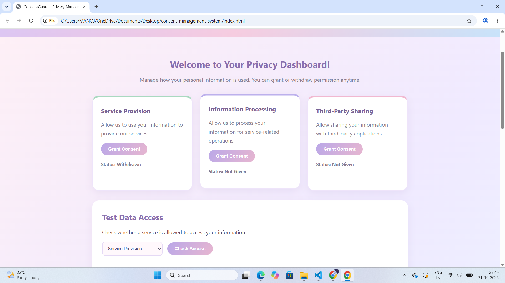

# ConsentGuard – Purpose-Based Consent Management System

## 1. About the Project

ConsentGuard is a purpose-based consent management system designed to give users control over how their personal data is accessed and used.

It allows users to grant or withdraw consent separately for different purposes and prevents data access when consent is withdrawn.

## 2. Problem Statement

**Problem ID:** A3-PS002-TC273

Existing digital platforms may continue accessing personal information even after users withdraw their consent.

ConsentGuard aims to provide transparent, secure, and effective management of user consent through purpose-based permissions.

## 3. Key Features

- Separate consent management for different purposes.
- Grant and withdraw consent.
- Check current consent status.
- Verify consent before allowing data access.
- Automatically deny access when consent is inactive.
- Maintain audit logs of consent changes and access decisions.
- Store privacy notice version and timestamps.

## 4. Consent Purposes

1. Service Provision
2. Information Processing
3. Third-Party Sharing

## 5. Technology Stack

**Frontend:** HTML5, CSS3, JavaScript

**Backend:** Java 17, Spring Boot, Spring Web

**Storage:** In-memory storage for the current prototype.

## 6. Project Structure

```text
A3-PS002-TC273/
│
├── consent-management-system/
│   ├── backend/
│   └── src/
│
├── src/
│   └── main/java/consentgaurd/
│       ├── BackendApplication.java
│       ├── ConsentController.java
│       └── HelloController.java
│
├── README.md
├── A3-PS002-TC273_20261014_182149_0000.pdf
└── Proposed-structure-hackathon.pdf
```

## 7. API Endpoints

| Method | Endpoint | Purpose |
|---|---|---|
| POST | `/api/consent/grant` | Grant consent |
| POST | `/api/consent/withdraw` | Withdraw consent |
| GET | `/api/consent/status` | Check consent status |
| POST | `/api/data/access` | Verify data access |
| GET | `/api/audit` | View audit logs |

## 8. How to Run the Backend

1. Open the project in Visual Studio Code.
2. Open the terminal.
3. Navigate to the backend folder:

```powershell
cd consent-management-system/backend
```

4. Start the Spring Boot application:

```powershell
.\mvnw.cmd spring-boot:run
```

5. Keep the backend running on port 8080.

## 9. Testing

The following scenarios can be tested:

- Grant consent and verify that data access is allowed.
- Withdraw consent and verify that data access is denied.
- Check consent status.
- View audit logs.
- Verify that unauthorized data access is blocked.

## 10. Future Scope

- MySQL database integration.
- User authentication and role-based access control.
- Stronger API security.
- Integration with government digital platforms.
- AI-based enhancements for future innovation.

## 11. Team Information

**Team Name:** Hacksphere

**Project:** ConsentGuard
  **project information video:**
https://youtube.com/shorts/yqzj_vtK06g?si=3RbQZmZyVwKiz9Eu
## 12. Important Note

This project is a working demonstration prototype. Consent records and audit logs are currently stored in backend memory and are reset when the backend restarts.

## Project Screenshots

### ConsentGuard Homepage


### Consent Granted


### Consent Withdrawn


### Access Denied
![Access Denied]

### Audit Logs
![Audit Logs]


